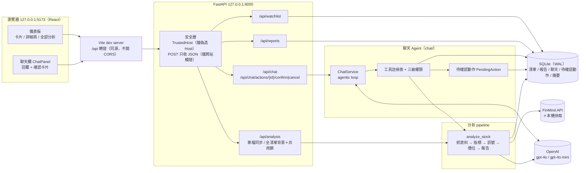
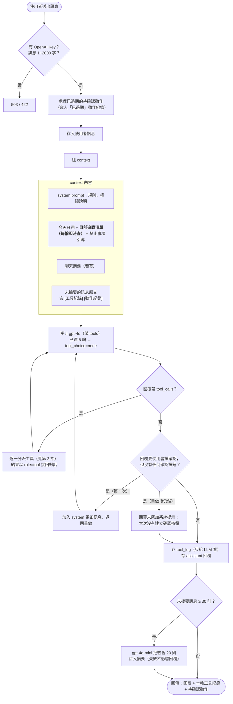
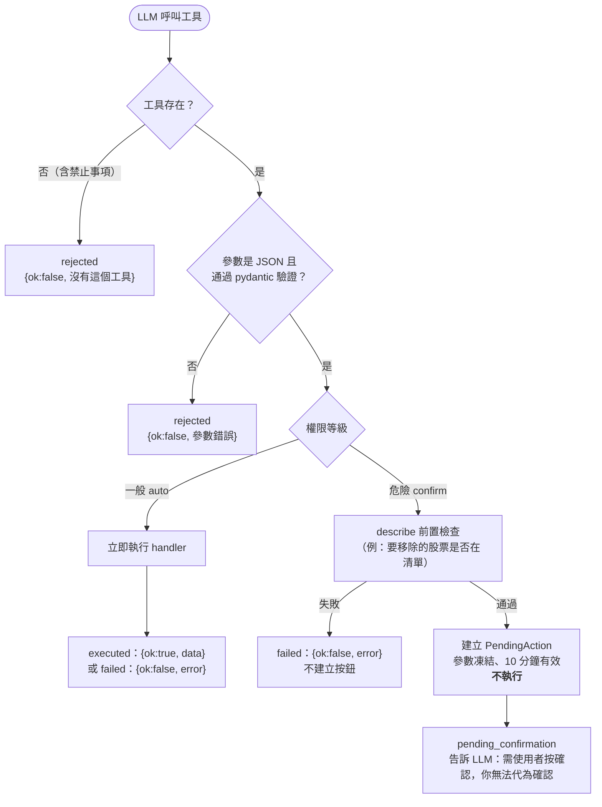
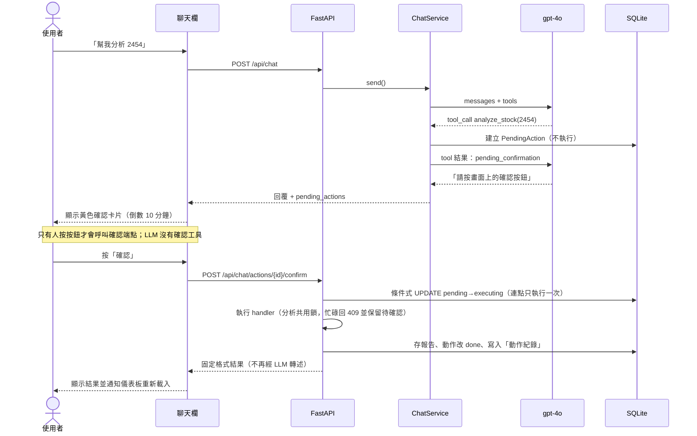
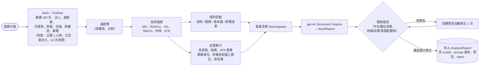

# StockAgent 系統架構

本文件依目前程式碼繪製，重點在 **Agent（聊天）流程**。圖使用 Mermaid，GitHub 與 VS Code 的 Markdown 預覽可直接顯示。

---

## 1. 系統總覽

---

## 2. Agent 單輪流程（`ChatService.send`）

一次使用者訊息 = 一輪。LLM 可連續呼叫工具多次，但**危險動作永遠不會在這裡執行**。

---

## 3. 工具分派與三級權限

| 等級 | 工具 / 操作 | 行為 |
|---|---|---|
| 一般 | `list_watchlist`、`add_watchlist_stock`、`get_latest_price`、`get_stock_report`、`get_report_history` | 直接執行 |
| 危險 | `remove_watchlist_stock`、`analyze_stock`（花 OpenAI 費用） | 只建立待確認動作，**人按按鈕才執行** |
| 禁止 | 分析整份清單、下單交易、改設定 / API Key | 不註冊成工具，system prompt 只提供文字引導 |

分級寫死在程式並有測試保護，不開放設定檔修改。

---

## 4. 危險動作的確認流程（人機協作）

取消 → `cancelled`；超過 10 分鐘 → `expired`；兩者都寫入動作紀錄，下一輪 LLM 看得到。

---

## 5. 分析 pipeline（`analyze_stock`）

聊天的 `analyze_stock`、儀表板的「分析 / 全部分析」都走這條路。

---

## 6. 防止 LLM 說謊或出錯的機制（實測後加入）

| 問題（實測發現） | 機制 |
|---|---|
| LLM 宣稱「請按確認」但沒呼叫工具 | 後端檢查：要使用者按確認卻沒有任何確認按鈕 → 退回重做一次，仍如此則加系統提示 |
| 歷史只有文字，LLM 模仿「請按確認」 | 每輪存 `tool_log`，讓 LLM 看到過去確實呼叫過工具 |
| 使用者說「我已經按了」，LLM 就相信 | prompt：是否執行只以「動作紀錄」為準 |
| 儀表板上的變動，聊天不知道 | 每輪即時把目前追蹤清單放進 context |
| 報告價格不在價位清單、買賣點矛盾 | 報告價格檢查 + 自動修正 |
| 新聞內容夾帶指令 | prompt 規定工具結果是資料不是指令；危險動作由後端強制擋下 |
